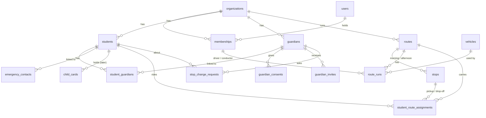

# Data Model

> As built after Sprint 3. Source of truth: `backend/app/models/` and `backend/alembic/versions/`.
> Update this page whenever a migration changes the tables.

## Principles

- **Every row belongs to one organization** (D-10), except `users` and the auth tokens. Every school-data table
  has `organization_id`, cascading on delete.
- **The API enforces cross-table tenancy.** The database cannot check that, say, a child and the stop they are
  assigned to belong to the same school; every id from a path or payload is loaded with `get_owned_or_404`, and
  another school's row is reported as missing (D-26).
- **Ids are random UUIDs.** Timestamps are UTC (`created_at`, `updated_at`).
- **Enums are stored as text** (VARCHAR 32), so adding a value needs no migration.
- **History is kept, not overwritten**: consents, route assignments and stop-change requests are append-or-close.
- **Collect the minimum about children**: no date of birth, no photo.

## Tables

### Accounts and tenancy (Sprint 2)

| Table | Holds | Rules |
|---|---|---|
| `organizations` | A tenant: `school` now, `operator` later | — |
| `users` | A person who can sign in; `is_platform_admin` for Tafi staff | Email unique |
| `memberships` | A user's role in one organization: `school_admin`, `driver`, `conductor` | One per user per organization |
| `invitations` | Single-use, expiring staff invite (hashed token) | D-18 |
| `password_reset_tokens` | Single-use, expiring reset (hashed token) | D-18 |

### Children and guardians (Sprint 3)

| Table | Holds | Rules |
|---|---|---|
| `students` | First and last name, class, `active` / `inactive` | An active child always has at least one guardian (API) |
| `guardians` | Name, WhatsApp number (E.164), email, `invited` / `confirmed` | Number unique **per school**: siblings share one guardian; the same parent at two schools is two rows |
| `student_guardians` | The link: relationship, `is_primary`, `receives_messages` | One link per child and guardian; exactly one primary per child (API) |
| `guardian_consents` | Consent version, method (`invite_link`, `school_recorded`), given, withdrawn, recorded by | Append-only; messaging needs a current row (D-22, D-27) |
| `guardian_invites` | The guardian's link: hashed token, expiry, used | A new link retires the earlier unused one |
| `emergency_contacts` | Name, phone (landlines allowed), relationship | — |
| `child_cards` | Random code, `active` / `lost` / `revoked` | Unused until scanning (D-24); the code holds no personal data |

### Routes and vehicles (Sprint 3)

| Table | Holds | Rules |
|---|---|---|
| `routes` | Code (e.g. R1), name/area, active | Code unique per school |
| `stops` | Name, landmark, sequence (morning order), optional coordinates | Afternoon runs use the reverse order. A stop a child currently uses cannot be removed (API) |
| `vehicles` | Plate, seats, active | Plate unique per school; an inactive vehicle cannot be given a run (API) |
| `route_runs` | One per route per direction: departure time, vehicle, driver, conductor | **Driver required** (database), conductor optional (D-21). A driver on a run cannot be deleted until replaced |
| `student_route_assignments` | Route, pickup stop, drop-off stop, active from / to | **One current assignment per child** (`active_to` empty; partial unique index). Changes take effect today, Kenya time (D-28) |
| `stop_change_requests` | Requested stop or a described place; `pending` / `approved` / `declined` | The school decides (D-22) |

## Where the rules live

| Rule | Enforced by |
|---|---|
| Tenant of every request | `backend/app/api/deps.py` — `CurrentMembership`, `SchoolAdmin`, `Crew`, `get_owned_or_404` |
| Phone numbers to E.164 | `backend/app/schemas/common.py` — `Phone`, `WhatsAppNumber` |
| Consent and `can_message` | `backend/app/services/consent.py` |
| Route assignment and history | `backend/app/api/routes/school_students.py` |
| Roster import | `backend/app/services/roster_import.py` |

## Coming next

- **Sprint 5:** an outbox and a notification log for WhatsApp messages; parent sign-in codes.
- **Sprint 6:** terms, invoices, payments, platform plans and prices.

### Trips (Sprint 4)

| Table | Holds | Rules |
|---|---|---|
| `trips` | One run of one route on one day: `route_run_id`, `service_date`, `status` (`scheduled` / `active` / `completed` / `cancelled`), when it started and ended and by which membership | Unique on `(route_run_id, service_date)`. The run supplies the driver, the conductor and the vehicle |
| `boarding_events` | One child's state change: `kind` (`boarded` / `dropped_off` / `absent`), `recorded_by_membership_id`, `method` (`manual` now, `scan` later), when and where | The API refuses a second boarding, a drop-off without a boarding, an absent after any other state, any event on a finished trip, and any child not on the route that day (D-21, D-24) |
| `trip_locations` | A position shared while the trip is running: `latitude`, `longitude`, `accuracy_m`, `recorded_at`, and who sent it | Recorded only while the trip is `active`. **A trail is expected to have gaps** — a phone browser stops sending location when the screen locks (T1-11) |

**A driver working alone** must confirm the vehicle is stopped before marking; the API checks how recent that
confirmation is (D-21, D-32). A conductor marks without it.
